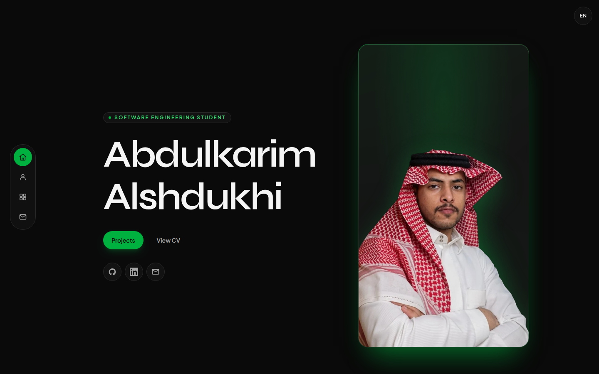
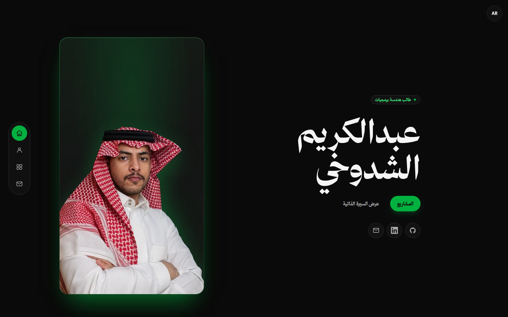
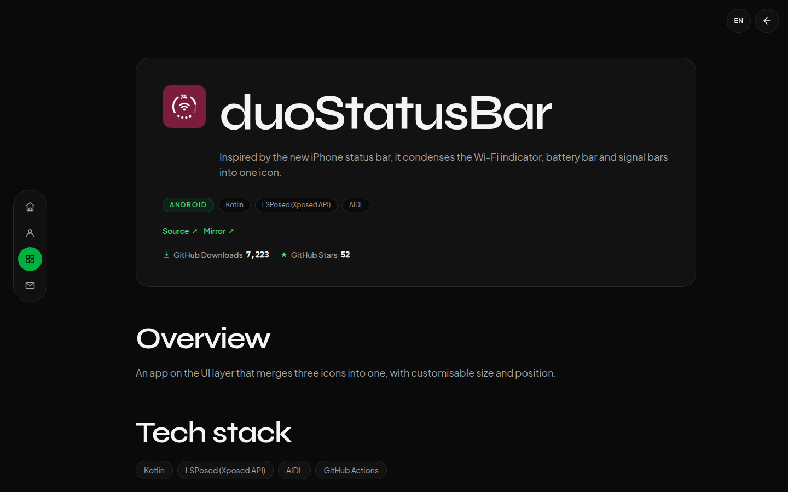
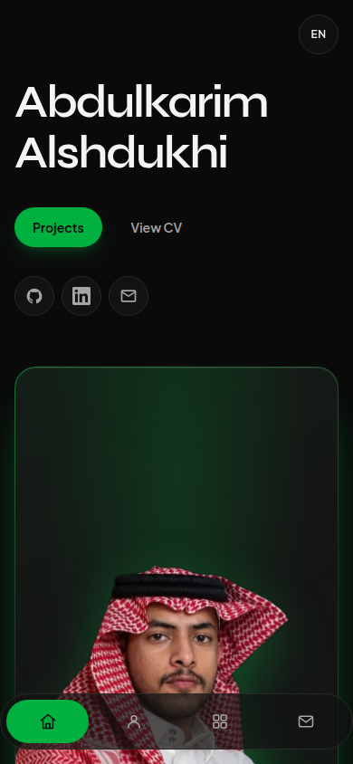

# Portfolio Template

An open-source, config-driven portfolio for developers. One Next.js 16 App
Router site, React 19, TypeScript, Tailwind CSS v4, validated JSON content,
client-side locales, a desktop dock and mobile bar, and a setup wizard that
turns the demo into your portfolio.

The screenshots below show the author's live portfolio at
[abdulkarim.dev](https://abdulkarim.dev), built with this template. The
repository's own demo persona, projects, and assets remain fictional; replace
them with your own work.

## Screenshots

| Home (English, dark)                                                          | Home (Arabic, RTL)                                                            |
| ----------------------------------------------------------------------------- | ----------------------------------------------------------------------------- |
|           |             |

| Project detail                                                             | Mobile home                                                          |
| -------------------------------------------------------------------------- | -------------------------------------------------------------------- |
|            |             |

## 🤖 Copy this message for your agent

```
Set up this portfolio template for me. Read AGENTS.md first.

Ask me only for:
1) How many projects I have (0–50).
2) English only, or English plus another locale.
3) My name, role, pitch, public email, and canonical site URL.
4) GitHub, LinkedIn, and website links (or none).
5) Optional: CV PDF path, CV DOCX download path, hero photo, and laptop frame sequence.
6) Which features to enable: CV, contact, metrics, 3D hero, and laptop.

Then run `npm run setup` (interactive, or with the flags in docs/SETUP.md), replace the demo content and demo images with mine, keep any project marked `"demo": false`, and run `npm run verify:fast` plus `node scripts/check-privacy.mjs`. Never invent personal data, commit secrets, or weaken the privacy scan, budgets, or tests.
```

For a richer agent brief, see [`AGENTS.md`](AGENTS.md).

## Features

- Single-page site with a vertical desktop dock and a mobile bottom bar
- Live theme and locale switching without a page reload, including RTL layouts
- Projects from 0 to N, loaded from `content/projects/*.json`
- Project detail pages with overview, tech stack, feature lenses, and deep-dive
- Animated hero card and a scroll-driven laptop visual, both with reduced-motion
  fallbacks
- Optional CV preview modal, contact form, and live metrics
- Zod-validated site config, projects, and locale dictionaries with actionable
  build errors
- SEO: canonical URLs, Open Graph/Twitter metadata, JSON-LD, sitemap, robots,
  and a generated 1200×630 social image
- Accessibility coverage with Playwright + axe, keyboard-friendly controls, and
  skip navigation
- Performance gates: per-route first-load JavaScript budgets, CSS budget,
  Lighthouse budgets, and a dedicated FPS harness
- Interactive setup wizard with non-interactive flags, privacy scanning, and CI
  template-smoke jobs

## Quick start

1. Select **Use this template** on GitHub, or clone your copy:

   ```bash
   git clone <your-repository-url> my-portfolio
   cd my-portfolio
   ```

2. Install dependencies:

   ```bash
   npm ci
   ```

3. Run the setup wizard and answer the project, language, identity, and feature
   questions:

   ```bash
   npm run setup
   ```

4. Start the development server:

   ```bash
   npm run dev
   ```

Open [http://localhost:3000](http://localhost:3000).

Non-interactive setup is also supported:

```bash
npm run setup -- --yes --projects=3 --langs=en,ar
```

See [`docs/SETUP.md`](docs/SETUP.md) for every flag, and
[`docs/CONTENT.md`](docs/CONTENT.md) for the content model.

## Commands

| Command               | Purpose                                             |
| --------------------- | --------------------------------------------------- |
| `npm run dev`         | Start the development server                        |
| `npm run build`       | Production build plus first-load budget check       |
| `npm start`           | Serve the production build                          |
| `npm run setup`       | Configure identity, projects, locales, and features |
| `npm run typecheck`   | TypeScript, no emit                                 |
| `npm run lint`        | ESLint                                              |
| `npm test`            | Vitest unit tests                                   |
| `npm run test:e2e`    | Playwright end-to-end tests                         |
| `npm run test:a11y`   | Playwright + axe accessibility tests                |
| `npm run test:visual` | Visual Playwright tests                             |
| `npm run test:fps`    | FPS harness (tagged `@fps`)                         |
| `npm run size`        | Check the configured first-load and CSS budgets     |
| `npm run lighthouse`  | Lighthouse CI against home and project detail       |
| `npm run knip`        | Detect unused files and exports                     |
| `npm run verify:fast` | Typecheck, lint, unit tests, knip, privacy scan     |

## Configuration reference

`content/site.json` is the source of truth for the site. It is validated by
`SiteConfigSchema` in `src/content/schema.ts`, parsed by `site.config.ts`, and
the build fails with a path-specific error if a value is invalid.

| Field               | Type                    | Notes                                                           |
| ------------------- | ----------------------- | --------------------------------------------------------------- |
| `name`              | string                  | Your display name                                               |
| `role`              | localized string        | Required in the default locale                                  |
| `pitch`             | localized string        | Required in the default locale                                  |
| `email`             | email                   | Public contact address                                          |
| `url`               | URL                     | Canonical site URL and allowed contact origin                   |
| `links`             | object                  | `github`, `linkedin`, and `website` are URL or null             |
| `defaultLocale`     | locale code             | Must appear in `locales`                                        |
| `locales`           | array                   | Each locale has `code`, `label`, `dir`, `htmlLang`              |
| `features`          | object                  | Five boolean feature flags                                      |
| `cv.file`           | site path or null       | PDF previewed in the CV section                                 |
| `cv.downloadFile`   | site path or null       | Optional download path (DOCX) while `cv.file` stays the preview |
| `hero.photo`        | site path or null       | Hero portrait; null uses the demo avatar                        |
| `hero.laptopFrames` | site path array or null | Scroll-scrub frame sequence; null uses the CSS demo laptop      |
| `hero.laptopMobileFrames` | site path array or null | Optional mobile frame sequence; null reuses the desktop frames |
| `about.intro`       | localized string        | About section copy and laptop-screen intro                      |
| `contact.recipient` | email                   | Contact recipient                                               |
| `contact.labels`    | localized string array  | Options for the contact form Label field                        |

Localized values are objects keyed by locale code. The default locale key is
required. Unknown locales in site-level localized values are rejected, and
unknown top-level keys fail validation.

### Feature flags

Set any flag to `false` to remove that part of the page:

| Flag       | Controls                                                  |
| ---------- | --------------------------------------------------------- |
| `cv`       | CV section with preview modal, download, and new-tab link |
| `contact`  | Contact form and dock link                                |
| `metrics`  | Live downloads and GitHub stars, with static fallbacks    |
| `splash3d` | 3D hero card                                              |
| `laptop`   | Scroll-driven laptop visual                               |

The page remains usable with every flag disabled.

## Content authoring

Each file in `content/projects/` must validate against `ProjectSchema`. A
minimal project looks like this:

```json
{
  "slug": "demo-project-one",
  "demo": true,
  "name": { "en": "Demo Project One" },
  "summary": { "en": "A short card summary." },
  "description": { "en": "A longer project description." },
  "order": 1,
  "platform": "web",
  "tech": ["TypeScript", "Next.js"],
  "features": [
    {
      "title": { "en": "Fast first paint" },
      "oneLiner": {
        "en": "A server-rendered shell reaches the screen quickly."
      },
      "description": { "en": "Why this feature matters." },
      "tags": ["Performance", "UX"],
      "media": {
        "src": "/demo/feature-1.svg",
        "alt": {
          "en": "Abstract dashboard with a fast-loading page skeleton."
        },
        "type": "image"
      },
      "evidence": { "en": "Measured with a performance budget on every build." }
    }
  ],
  "metrics": null,
  "sources": { "github": null, "mirror": null },
  "deepDive": {
    "architecture": { "en": "A server-rendered app with validated content." },
    "code": { "language": "TypeScript", "snippet": "export const value = 1;" }
  },
  "repo": null,
  "store": null,
  "packageId": null,
  "logo": "/demo/logo-1.svg"
}
```

Rules and conventions:

- Slugs are unique, lowercase, and hyphenated. Projects sort by `order`, then
  by slug.
- Every localized string needs the default locale key.
- `platform` is `web`, `android`, `ios`, or `cross-platform`.
- Each feature needs `title`, `oneLiner`, `description`, and one or more unique
  tags from `UX`, `Security`, `Testing`, and `Performance`.
- `features[].media` is `null` or `{ "src", "alt", "type" }`, where `type` is
  `image` or `video`. Keep videos muted, looping, `playsInline`, six seconds or
  shorter, and at most 2.5 MB. Keep images at or below 1.5 MB. Prefer WebM over
  GIF.
- `features[].evidence` is `null` or a localized note about what was checked and
  how.
- `metrics` is `null` or a static fallback
  `{ "github": number | null, "mirror": number | null }`.
- `sources` holds optional full `owner/repo` slugs. Stars come from `github`;
  downloads sum releases from both sources.
- `deepDive` holds optional architecture copy and a short code sample.
- Set `demo: false` for real work. The wizard never overwrites real projects
  unless you pass `--force`.
- An empty projects folder is valid and renders the localized empty state.

Project detail pages render in a fixed block order: header, overview, tech
stack, features (with lens filters), and deep-dive. Lenses include `All`, `UX`,
`Security`, `Testing`, and `Performance`; a deep link such as
`/projects/<slug>#security` selects a lens without navigating.

The UI dictionary in `content/locales/*.json` holds navigation, hero, empty
state, contact, and footer strings. See [`docs/CONTENT.md`](docs/CONTENT.md) for
the complete reference and [`docs/CUSTOMIZE.md`](docs/CUSTOMIZE.md) for theming.

## Metrics sources

With `metrics` enabled, project cards and detail headers show downloads and
GitHub stars. Downloads combine `assets[].download_count` from releases in both
`sources.github` and `sources.mirror`; stars come from the GitHub repository.

The static `metrics` values render immediately, then live values replace them
after mount. Successful responses are cached in `sessionStorage` under a
`metrics:<slug>` key that includes both source slugs for one hour. Failed or
malformed requests are silent and leave the fallback in place. Google Play
install counts and review status are intentionally not shown. See
[`docs/FAQ.md`](docs/FAQ.md) if numbers do not update.

## Contact form and environment

With `features.contact` on, the contact section renders a client form (Name,
Email, Label, Message) that posts JSON to `/api/contact`. Label options come
from `contact.labels[locale]`.

The endpoint validates with a shared Zod schema, checks the origin against the
configured `url`, ignores submissions with the hidden `company` honeypot, and
allows 5 requests per 10 minutes per IP. With `RESEND_API_KEY` set it sends
through Resend using `CONTACT_FROM` / `CONTACT_TO` (recipient defaults to
`contact.recipient`). Without a key, development returns a dev `202`; production
returns `503`.

```bash
RESEND_API_KEY=re_...
CONTACT_FROM="Portfolio <you@example.com>"
CONTACT_TO=you@example.com
```

Copy `.env.example` to `.env.local` for local work. Never commit real values.
`CONTACT_DEV_MODE=1` allows the dev `202` from a production server process for
tests; do not set it in production. See [`docs/DEPLOY.md`](docs/DEPLOY.md) for
the full status matrix and rate-limit notes.

## Locales

The demo ships English and Arabic. Locale metadata drives `lang` and `dir` on
the document. The floating theme and locale controls apply changes without a
full page reload and remember the choice in local storage.

To add a locale:

1. Add its `code`, `label`, `dir`, and `htmlLang` to `locales` in
   `content/site.json` (and the matching key to localized site values).
2. Copy `content/locales/en.json` to `content/locales/<code>.json` and translate
   the UI strings.
3. Keep product names, framework names, and other technical names untranslated.

The setup wizard can add one additional locale by copying English and marking
the file with `_todo`.

## SEO and metadata

`siteConfig.url` (from `content/site.json`) is the canonical public origin. Set
it to the production domain before building; contact origin checks use it too.

- `/sitemap.xml` is generated at build time from the home page and every
  `content/projects/*.json` entry. Home has priority `1`; project pages use
  `0.7`. `lastModified` is the build date.
- `/robots.txt` allows all crawlers and points at
  `<siteConfig.url>/sitemap.xml`.
- `/opengraph-image` renders a static 1200×630 PNG from the site name, default
  role, and pitch. It makes no network requests.
- The root layout emits `canonical`, Open Graph, Twitter card, and a schema.org
  `Person` JSON-LD script. Project pages override canonical, title,
  description, and OG type `article`.
- Every route has a unique title and description.

Change `url`, `name`, `role`, or `pitch` in `content/site.json` and rebuild to
regenerate all of the above.

## Performance and quality gates

`npm run build` compiles with Next.js and then runs
`scripts/first-load-budget.mjs`. The route budgets are:

| Route              | First-load JS (gzip) |
| ------------------ | -------------------- |
| `/`                | 180 kB               |
| `/projects/[slug]` | 180 kB               |
| All CSS            | 30 kB                |

`npm run size` checks the same assets through size-limit, and
`npm run lighthouse` runs Lighthouse CI three times against the home page and a
project detail page. Lighthouse fails below 0.9 for performance,
accessibility, best practices, or SEO, or when the configured LCP, CLS, TBT,
FCP, or script budgets regress. The FPS harness is available through
`npm run test:fps`.

The `test:a11y` suite scans the main routes with axe and fails on serious or
critical violations. Keep reduced-motion behavior intact when changing the hero
and laptop animations.

## Deploy

The contact form needs a request-time server for `/api/contact`, so the default
build runs as a Next.js server. The documented Cloudflare target is OpenNext on
Cloudflare Workers (see [`docs/adr/ADR-001-deploy.md`](docs/adr/ADR-001-deploy.md)).
A pure static export would need a separate contact endpoint or the contact
feature turned off.

Set `RESEND_API_KEY`, `CONTACT_FROM`, and `CONTACT_TO` as host secrets, and wire
a shared rate-limit store for production (the in-memory limiter is per
instance). Read [`docs/DEPLOY.md`](docs/DEPLOY.md) for the full matrix.

## Documentation

- [`docs/SETUP.md`](docs/SETUP.md) — wizard flags and first-run setup
- [`docs/CONTENT.md`](docs/CONTENT.md) — site, project, locale, and asset schema
- [`docs/CUSTOMIZE.md`](docs/CUSTOMIZE.md) — colors, sections, and metadata
- [`docs/ARCHITECTURE.md`](docs/ARCHITECTURE.md) — engine/content split and data flow
- [`docs/DEPLOY.md`](docs/DEPLOY.md) — hosting, env vars, and contact statuses
- [`docs/FAQ.md`](docs/FAQ.md) — common tasks and troubleshooting
- [`AGENTS.md`](AGENTS.md) — onboarding for AI coding agents

## Contributing

Read [`CONTRIBUTING.md`](CONTRIBUTING.md) before opening a pull request.
Security reports go through GitHub Security Advisories as described in
[`SECURITY.md`](SECURITY.md). Community participation is covered by
[`CODE_OF_CONDUCT.md`](CODE_OF_CONDUCT.md).

## License

Code is licensed under the MIT License. See [`LICENSE`](LICENSE).

Demo assets are original generated SVG artwork and a generic demo CV PDF,
dedicated to the public domain under CC0. Fonts are self-hosted under the SIL
Open Font License. GSAP is distributed under its own standard license, not MIT.
No third-party logos, screenshots, or media are bundled. See [`NOTICE`](NOTICE)
for details.

Copyright (c) 2026 Abdulkarim.
